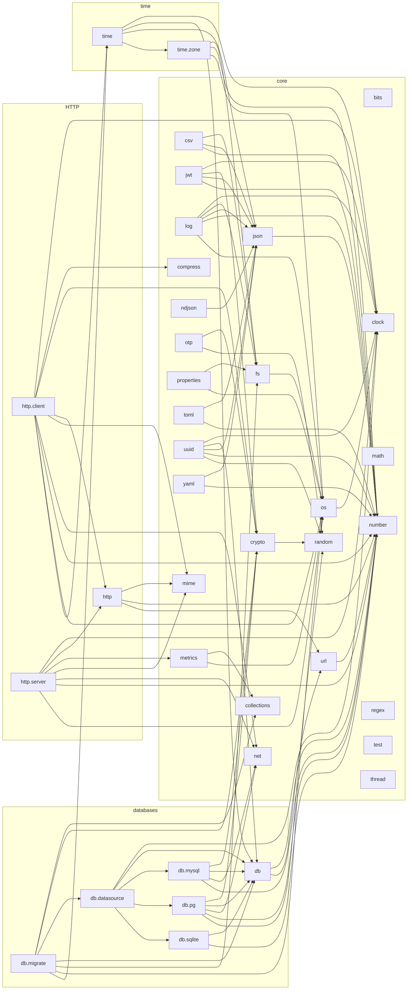

# Library dependencies

Which bundled module `use`s which, read from the `use` lines under `lib/` (generated by
`tools/gen_lib_deps.py`; `make corelib-reference` regenerates it). An arrow runs from a module to one it
uses. Boxes are named by module, with the folder in front when it is not `core` (`http.server`, `db.pg`); a program writes just the module (`use server`). The prelude is in every program and is left out; a module with no arrows uses only the prelude
and its own natives.

## By layer

A module is on layer 0 when it uses no other module, and one more than the deepest module it uses
otherwise: everything on a layer depends only on lower layers.

| Layer | Modules |
|---|---|
| 0 | `bits`, `clock`, `collections`, `compress`, `math`, `mime`, `net`, `number`, `random`, `regex`, `test`, `thread` |
| 1 | `crypto`, `json`, `os`, `url` |
| 2 | `db`, `fs`, `http`, `jwt`, `metrics`, `ndjson`, `otp`, `toml`, `yaml` |
| 3 | `csv`, `log`, `mysql`, `pg`, `properties`, `server`, `sqlite`, `uuid`, `zone` |
| 4 | `datasource`, `time` |
| 5 | `client`, `migrate` |

## Each module

| Module | Uses | Used by |
|---|---|---|
| `bits` | - | - |
| `client` | `clock`, `compress`, `crypto`, `http`, `mime`, `net`, `number`, `os`, `time` | - |
| `clock` | - | `client`, `datasource`, `jwt`, `log`, `os`, `server`, `time`, `uuid` |
| `collections` | - | `metrics`, `migrate` |
| `compress` | - | `client` |
| `crypto` | `random` | `client`, `jwt`, `migrate`, `mysql`, `otp`, `pg` |
| `csv` | `fs`, `json`, `number` | - |
| `datasource` | `clock`, `db`, `mysql`, `pg`, `sqlite` | `migrate` |
| `db` | `number`, `url` | `datasource`, `migrate`, `mysql`, `pg`, `sqlite`, `time`, `uuid` |
| `fs` | `os` | `csv`, `log`, `migrate`, `properties`, `zone` |
| `http` | `mime`, `number`, `url` | `client`, `server` |
| `json` | `number` | `csv`, `jwt`, `log`, `ndjson`, `time`, `toml`, `uuid`, `yaml` |
| `jwt` | `clock`, `crypto`, `json`, `number` | - |
| `log` | `clock`, `fs`, `json`, `number`, `os` | - |
| `math` | - | - |
| `metrics` | `collections`, `os` | `server` |
| `migrate` | `collections`, `crypto`, `datasource`, `db`, `fs`, `os`, `time` | - |
| `mime` | - | `client`, `http`, `server` |
| `mysql` | `crypto`, `db`, `net`, `number` | `datasource` |
| `ndjson` | `json` | - |
| `net` | - | `client`, `mysql`, `pg`, `server` |
| `number` | - | `client`, `csv`, `db`, `http`, `json`, `jwt`, `log`, `mysql`, `pg`, `server`, `sqlite`, `toml`, `url`, `uuid`, `yaml`, `zone` |
| `os` | `clock` | `client`, `fs`, `log`, `metrics`, `migrate`, `properties`, `server`, `zone` |
| `otp` | `crypto`, `random` | - |
| `pg` | `crypto`, `db`, `net`, `number`, `random` | `datasource` |
| `properties` | `fs`, `os` | - |
| `random` | - | `crypto`, `otp`, `pg`, `uuid` |
| `regex` | - | - |
| `server` | `clock`, `http`, `metrics`, `mime`, `net`, `number`, `os` | - |
| `sqlite` | `db`, `number` | `datasource` |
| `test` | - | - |
| `thread` | - | - |
| `time` | `clock`, `db`, `json`, `zone` | `client`, `migrate` |
| `toml` | `json`, `number` | - |
| `url` | `number` | `db`, `http` |
| `uuid` | `clock`, `db`, `json`, `number`, `random` | - |
| `yaml` | `json`, `number` | - |
| `zone` | `fs`, `number`, `os` | `time` |

## Why some modules are separate

- `db` holds what the database modules share (`SqlValue`, `Row`, `DbError`, the URL parser) so that `pg`,
  `mysql`, `sqlite`, `time` and `uuid` can use it without using `datasource`, which uses them.
- `http` holds what `server` and `client` share (`Request`, `Response`, `Header`, `HttpMethod`) so neither
  needs the other.
- `zone` reads the operating system's zone files for `time`; it needs only `fs`, `number` and `os`.
