# Library dependencies

Which bundled module `use`s which, read from the `use` lines under `lib/` (generated by
`tools/gen_lib_deps.py`; `make corelib-reference` regenerates it). An arrow runs from a module to one it
uses. Boxes are named by module, with the folder in front when it is not `core` (`http.server`, `db.pg`); a program writes just the module (`use server`). The prelude is in every program and is left out; a module with no arrows uses only the prelude
and its own natives.

```mermaid
flowchart LR
    subgraph group_core["core"]
        batch["batch"]
        bits["bits"]
        charset["charset"]
        clock["clock"]
        codec["codec"]
        compress["compress"]
        crypto["crypto"]
        csv["csv"]
        derive_json["derive_json"]
        derive_ord["derive_ord"]
        derive_properties["derive_properties"]
        derive_reflect["derive_reflect"]
        derive_validate["derive_validate"]
        derive_xml["derive_xml"]
        encoding["encoding"]
        expr["expr"]
        fs["fs"]
        ini["ini"]
        io["io"]
        json["json"]
        jwt["jwt"]
        locale["locale"]
        log["log"]
        markdown["markdown"]
        math["math"]
        meta["meta"]
        metrics["metrics"]
        mime["mime"]
        ndjson["ndjson"]
        net["net"]
        number["number"]
        os["os"]
        otp["otp"]
        paging["paging"]
        process["process"]
        properties["properties"]
        random["random"]
        regex["regex"]
        template["template"]
        test["test"]
        thread["thread"]
        toml["toml"]
        url["url"]
        uuid["uuid"]
        validate["validate"]
        xml["xml"]
        yaml["yaml"]
    end
    subgraph group_db["databases"]
        datasource["db.datasource"]
        db["db"]
        derive_entity["db.derive_entity"]
        derive_repository["db.derive_repository"]
        derive_row["db.derive_row"]
        eql["db.eql"]
        memdb["db.memdb"]
        migrate["db.migrate"]
        mysql["db.mysql"]
        pg["db.pg"]
        sql["db.sql"]
        sqlite["db.sqlite"]
    end
    subgraph group_graphics["graphics"]
        chart["graphics.chart"]
        font["graphics.font"]
        geom["graphics.geom"]
        image["graphics.image"]
        layout["graphics.layout"]
        paint["graphics.paint"]
        pdf["graphics.pdf"]
        pdfobj["graphics.pdfobj"]
        raster["graphics.raster"]
        scene["graphics.scene"]
        shape["graphics.shape"]
        stroker["graphics.stroker"]
        svg["graphics.svg"]
        truetype["graphics.truetype"]
    end
    subgraph group_http["HTTP"]
        client["http.client"]
        derive_routes["http.derive_routes"]
        http["http"]
        rest["http.rest"]
        server["http.server"]
    end
    subgraph group_time["time"]
        schedule["time.schedule"]
        time["time"]
        zone["time.zone"]
    end
    subgraph group_ui["user interface"]
        a11y["ui.a11y"]
        atspi["ui.atspi"]
        controls["ui.controls"]
        desktop["ui.desktop"]
        edit["ui.edit"]
        focus["ui.focus"]
        ibus["ui.ibus"]
        icons["ui.icons"]
        navigate["ui.navigate"]
        terminal["ui.terminal"]
        theme["ui.theme"]
        widget["ui.widget"]
        window["ui.window"]
    end
    a11y --> geom
    a11y --> widget
    atspi --> a11y
    atspi --> widget
    batch --> datasource
    batch --> db
    batch --> time
    batch --> uuid
    chart --> geom
    chart --> paint
    chart --> scene
    chart --> shape
    client --> clock
    client --> compress
    client --> encoding
    client --> http
    client --> io
    client --> locale
    client --> mime
    client --> net
    client --> number
    client --> os
    client --> time
    codec --> charset
    codec --> csv
    codec --> json
    codec --> mime
    codec --> ndjson
    codec --> toml
    codec --> xml
    codec --> yaml
    controls --> a11y
    controls --> chart
    controls --> edit
    controls --> focus
    controls --> geom
    controls --> locale
    controls --> math
    controls --> number
    controls --> paint
    controls --> scene
    controls --> shape
    controls --> time
    controls --> widget
    crypto --> encoding
    crypto --> random
    csv --> charset
    csv --> fs
    csv --> io
    csv --> json
    csv --> number
    datasource --> clock
    datasource --> db
    db --> net
    db --> number
    db --> url
    derive_entity --> meta
    derive_entity --> template
    derive_json --> meta
    derive_json --> template
    derive_ord --> meta
    derive_ord --> template
    derive_properties --> meta
    derive_properties --> properties
    derive_properties --> template
    derive_reflect --> meta
    derive_repository --> derive_row
    derive_repository --> meta
    derive_repository --> template
    derive_routes --> meta
    derive_routes --> template
    derive_row --> meta
    derive_row --> template
    derive_validate --> meta
    derive_validate --> template
    derive_xml --> meta
    derive_xml --> template
    desktop --> controls
    desktop --> geom
    desktop --> raster
    desktop --> scene
    desktop --> widget
    desktop --> window
    encoding --> locale
    encoding --> number
    eql --> datasource
    eql --> db
    eql --> locale
    eql --> sql
    eql --> time
    eql --> uuid
    expr --> json
    expr --> regex
    focus --> geom
    focus --> widget
    font --> charset
    font --> truetype
    fs --> charset
    fs --> io
    fs --> os
    geom --> math
    http --> fs
    http --> io
    http --> locale
    http --> mime
    http --> number
    http --> random
    http --> url
    ibus --> window
    icons --> fs
    icons --> ini
    icons --> math
    icons --> os
    icons --> shape
    icons --> svg
    image --> bits
    image --> compress
    image --> math
    image --> number
    image --> paint
    ini --> charset
    ini --> locale
    io --> charset
    json --> charset
    json --> math
    json --> number
    jwt --> clock
    jwt --> crypto
    jwt --> encoding
    jwt --> json
    jwt --> number
    layout --> font
    layout --> geom
    layout --> paint
    layout --> scene
    layout --> shape
    log --> clock
    log --> fs
    log --> json
    log --> locale
    log --> number
    log --> os
    markdown --> math
    memdb --> db
    memdb --> locale
    memdb --> sql
    metrics --> os
    migrate --> crypto
    migrate --> datasource
    migrate --> db
    migrate --> encoding
    migrate --> fs
    migrate --> os
    migrate --> time
    mime --> locale
    mysql --> crypto
    mysql --> db
    mysql --> net
    mysql --> number
    navigate --> a11y
    navigate --> controls
    navigate --> focus
    navigate --> widget
    ndjson --> charset
    ndjson --> json
    number --> locale
    os --> clock
    otp --> crypto
    otp --> encoding
    otp --> random
    paging --> codec
    paging --> json
    paging --> mime
    paint --> geom
    paint --> locale
    paint --> math
    pdf --> charset
    pdf --> font
    pdf --> geom
    pdf --> image
    pdf --> paint
    pdf --> pdfobj
    pdf --> scene
    pdf --> shape
    pdf --> truetype
    pdfobj --> compress
    pg --> crypto
    pg --> db
    pg --> encoding
    pg --> locale
    pg --> net
    pg --> number
    pg --> random
    process --> encoding
    process --> fs
    process --> os
    process --> random
    properties --> charset
    properties --> fs
    properties --> locale
    properties --> math
    properties --> os
    raster --> font
    raster --> geom
    raster --> image
    raster --> math
    raster --> paint
    raster --> scene
    raster --> shape
    raster --> stroker
    raster --> truetype
    rest --> clock
    rest --> codec
    rest --> http
    rest --> io
    rest --> metrics
    rest --> mime
    rest --> server
    rest --> url
    rest --> uuid
    scene --> geom
    scene --> paint
    scene --> shape
    schedule --> clock
    schedule --> locale
    schedule --> time
    server --> clock
    server --> codec
    server --> compress
    server --> fs
    server --> http
    server --> io
    server --> json
    server --> locale
    server --> metrics
    server --> mime
    server --> net
    server --> number
    server --> os
    server --> uuid
    shape --> geom
    shape --> math
    sql --> db
    sql --> fs
    sql --> locale
    sql --> number
    sqlite --> db
    sqlite --> number
    stroker --> geom
    stroker --> math
    stroker --> paint
    stroker --> shape
    svg --> geom
    svg --> locale
    svg --> math
    svg --> paint
    svg --> shape
    svg --> stroker
    svg --> xml
    template --> expr
    template --> json
    terminal --> charset
    terminal --> io
    test --> regex
    theme --> controls
    theme --> geom
    theme --> math
    theme --> paint
    theme --> widget
    time --> clock
    time --> db
    time --> json
    time --> locale
    time --> zone
    toml --> charset
    toml --> json
    toml --> locale
    toml --> number
    toml --> time
    truetype --> charset
    truetype --> geom
    truetype --> shape
    url --> charset
    url --> locale
    url --> number
    uuid --> clock
    uuid --> db
    uuid --> json
    uuid --> number
    uuid --> random
    validate --> regex
    widget --> font
    widget --> geom
    widget --> paint
    widget --> scene
    widget --> shape
    window --> charset
    xml --> charset
    xml --> io
    xml --> locale
    yaml --> charset
    yaml --> json
    yaml --> locale
    yaml --> number
    zone --> fs
    zone --> number
    zone --> os
```

## By layer

A module is on layer 0 when it uses no other module, and one more than the deepest module it uses
otherwise: everything on a layer depends only on lower layers.

| Layer | Modules |
|---|---|
| 0 | `bits`, `charset`, `clock`, `compress`, `edit`, `locale`, `math`, `meta`, `net`, `random`, `regex`, `thread` |
| 1 | `derive_reflect`, `geom`, `ini`, `io`, `markdown`, `mime`, `number`, `os`, `pdfobj`, `test`, `validate`, `window` |
| 2 | `encoding`, `fs`, `ibus`, `json`, `metrics`, `paint`, `shape`, `terminal`, `url`, `xml` |
| 3 | `crypto`, `csv`, `db`, `expr`, `http`, `image`, `log`, `ndjson`, `process`, `properties`, `scene`, `stroker`, `truetype`, `yaml`, `zone` |
| 4 | `chart`, `datasource`, `font`, `jwt`, `mysql`, `otp`, `pg`, `sql`, `sqlite`, `svg`, `template`, `time`, `uuid` |
| 5 | `batch`, `client`, `derive_entity`, `derive_json`, `derive_ord`, `derive_properties`, `derive_routes`, `derive_row`, `derive_validate`, `derive_xml`, `eql`, `icons`, `layout`, `memdb`, `migrate`, `pdf`, `raster`, `schedule`, `toml`, `widget` |
| 6 | `a11y`, `codec`, `derive_repository`, `focus` |
| 7 | `atspi`, `controls`, `paging`, `server` |
| 8 | `desktop`, `navigate`, `rest`, `theme` |

## Each module

| Module | Uses | Used by |
|---|---|---|
| `a11y` | `geom`, `widget` | `atspi`, `controls`, `navigate` |
| `atspi` | `a11y`, `widget` | - |
| `batch` | `datasource`, `db`, `time`, `uuid` | - |
| `bits` | - | `image` |
| `charset` | - | `codec`, `csv`, `font`, `fs`, `ini`, `io`, `json`, `ndjson`, `pdf`, `properties`, `terminal`, `toml`, `truetype`, `url`, `window`, `xml`, `yaml` |
| `chart` | `geom`, `paint`, `scene`, `shape` | `controls` |
| `client` | `clock`, `compress`, `encoding`, `http`, `io`, `locale`, `mime`, `net`, `number`, `os`, `time` | - |
| `clock` | - | `client`, `datasource`, `jwt`, `log`, `os`, `rest`, `schedule`, `server`, `time`, `uuid` |
| `codec` | `charset`, `csv`, `json`, `mime`, `ndjson`, `toml`, `xml`, `yaml` | `paging`, `rest`, `server` |
| `compress` | - | `client`, `image`, `pdfobj`, `server` |
| `controls` | `a11y`, `chart`, `edit`, `focus`, `geom`, `locale`, `math`, `number`, `paint`, `scene`, `shape`, `time`, `widget` | `desktop`, `navigate`, `theme` |
| `crypto` | `encoding`, `random` | `jwt`, `migrate`, `mysql`, `otp`, `pg` |
| `csv` | `charset`, `fs`, `io`, `json`, `number` | `codec` |
| `datasource` | `clock`, `db` | `batch`, `eql`, `migrate` |
| `db` | `net`, `number`, `url` | `batch`, `datasource`, `eql`, `memdb`, `migrate`, `mysql`, `pg`, `sql`, `sqlite`, `time`, `uuid` |
| `derive_entity` | `meta`, `template` | - |
| `derive_json` | `meta`, `template` | - |
| `derive_ord` | `meta`, `template` | - |
| `derive_properties` | `meta`, `properties`, `template` | - |
| `derive_reflect` | `meta` | - |
| `derive_repository` | `derive_row`, `meta`, `template` | - |
| `derive_routes` | `meta`, `template` | - |
| `derive_row` | `meta`, `template` | `derive_repository` |
| `derive_validate` | `meta`, `template` | - |
| `derive_xml` | `meta`, `template` | - |
| `desktop` | `controls`, `geom`, `raster`, `scene`, `widget`, `window` | - |
| `edit` | - | `controls` |
| `encoding` | `locale`, `number` | `client`, `crypto`, `jwt`, `migrate`, `otp`, `pg`, `process` |
| `eql` | `datasource`, `db`, `locale`, `sql`, `time`, `uuid` | - |
| `expr` | `json`, `regex` | `template` |
| `focus` | `geom`, `widget` | `controls`, `navigate` |
| `font` | `charset`, `truetype` | `layout`, `pdf`, `raster`, `widget` |
| `fs` | `charset`, `io`, `os` | `csv`, `http`, `icons`, `log`, `migrate`, `process`, `properties`, `server`, `sql`, `zone` |
| `geom` | `math` | `a11y`, `chart`, `controls`, `desktop`, `focus`, `layout`, `paint`, `pdf`, `raster`, `scene`, `shape`, `stroker`, `svg`, `theme`, `truetype`, `widget` |
| `http` | `fs`, `io`, `locale`, `mime`, `number`, `random`, `url` | `client`, `rest`, `server` |
| `ibus` | `window` | - |
| `icons` | `fs`, `ini`, `math`, `os`, `shape`, `svg` | - |
| `image` | `bits`, `compress`, `math`, `number`, `paint` | `pdf`, `raster` |
| `ini` | `charset`, `locale` | `icons` |
| `io` | `charset` | `client`, `csv`, `fs`, `http`, `rest`, `server`, `terminal`, `xml` |
| `json` | `charset`, `math`, `number` | `codec`, `csv`, `expr`, `jwt`, `log`, `ndjson`, `paging`, `server`, `template`, `time`, `toml`, `uuid`, `yaml` |
| `jwt` | `clock`, `crypto`, `encoding`, `json`, `number` | - |
| `layout` | `font`, `geom`, `paint`, `scene`, `shape` | - |
| `locale` | - | `client`, `controls`, `encoding`, `eql`, `http`, `ini`, `log`, `memdb`, `mime`, `number`, `paint`, `pg`, `properties`, `schedule`, `server`, `sql`, `svg`, `time`, `toml`, `url`, `xml`, `yaml` |
| `log` | `clock`, `fs`, `json`, `locale`, `number`, `os` | - |
| `markdown` | `math` | - |
| `math` | - | `controls`, `geom`, `icons`, `image`, `json`, `markdown`, `paint`, `properties`, `raster`, `shape`, `stroker`, `svg`, `theme` |
| `memdb` | `db`, `locale`, `sql` | - |
| `meta` | - | `derive_entity`, `derive_json`, `derive_ord`, `derive_properties`, `derive_reflect`, `derive_repository`, `derive_routes`, `derive_row`, `derive_validate`, `derive_xml` |
| `metrics` | `os` | `rest`, `server` |
| `migrate` | `crypto`, `datasource`, `db`, `encoding`, `fs`, `os`, `time` | - |
| `mime` | `locale` | `client`, `codec`, `http`, `paging`, `rest`, `server` |
| `mysql` | `crypto`, `db`, `net`, `number` | - |
| `navigate` | `a11y`, `controls`, `focus`, `widget` | - |
| `ndjson` | `charset`, `json` | `codec` |
| `net` | - | `client`, `db`, `mysql`, `pg`, `server` |
| `number` | `locale` | `client`, `controls`, `csv`, `db`, `encoding`, `http`, `image`, `json`, `jwt`, `log`, `mysql`, `pg`, `server`, `sql`, `sqlite`, `toml`, `url`, `uuid`, `yaml`, `zone` |
| `os` | `clock` | `client`, `fs`, `icons`, `log`, `metrics`, `migrate`, `process`, `properties`, `server`, `zone` |
| `otp` | `crypto`, `encoding`, `random` | - |
| `paging` | `codec`, `json`, `mime` | - |
| `paint` | `geom`, `locale`, `math` | `chart`, `controls`, `image`, `layout`, `pdf`, `raster`, `scene`, `stroker`, `svg`, `theme`, `widget` |
| `pdf` | `charset`, `font`, `geom`, `image`, `paint`, `pdfobj`, `scene`, `shape`, `truetype` | - |
| `pdfobj` | `compress` | `pdf` |
| `pg` | `crypto`, `db`, `encoding`, `locale`, `net`, `number`, `random` | - |
| `process` | `encoding`, `fs`, `os`, `random` | - |
| `properties` | `charset`, `fs`, `locale`, `math`, `os` | `derive_properties` |
| `random` | - | `crypto`, `http`, `otp`, `pg`, `process`, `uuid` |
| `raster` | `font`, `geom`, `image`, `math`, `paint`, `scene`, `shape`, `stroker`, `truetype` | `desktop` |
| `regex` | - | `expr`, `test`, `validate` |
| `rest` | `clock`, `codec`, `http`, `io`, `metrics`, `mime`, `server`, `url`, `uuid` | - |
| `scene` | `geom`, `paint`, `shape` | `chart`, `controls`, `desktop`, `layout`, `pdf`, `raster`, `widget` |
| `schedule` | `clock`, `locale`, `time` | - |
| `server` | `clock`, `codec`, `compress`, `fs`, `http`, `io`, `json`, `locale`, `metrics`, `mime`, `net`, `number`, `os`, `uuid` | `rest` |
| `shape` | `geom`, `math` | `chart`, `controls`, `icons`, `layout`, `pdf`, `raster`, `scene`, `stroker`, `svg`, `truetype`, `widget` |
| `sql` | `db`, `fs`, `locale`, `number` | `eql`, `memdb` |
| `sqlite` | `db`, `number` | - |
| `stroker` | `geom`, `math`, `paint`, `shape` | `raster`, `svg` |
| `svg` | `geom`, `locale`, `math`, `paint`, `shape`, `stroker`, `xml` | `icons` |
| `template` | `expr`, `json` | `derive_entity`, `derive_json`, `derive_ord`, `derive_properties`, `derive_repository`, `derive_routes`, `derive_row`, `derive_validate`, `derive_xml` |
| `terminal` | `charset`, `io` | - |
| `test` | `regex` | - |
| `theme` | `controls`, `geom`, `math`, `paint`, `widget` | - |
| `thread` | - | - |
| `time` | `clock`, `db`, `json`, `locale`, `zone` | `batch`, `client`, `controls`, `eql`, `migrate`, `schedule`, `toml` |
| `toml` | `charset`, `json`, `locale`, `number`, `time` | `codec` |
| `truetype` | `charset`, `geom`, `shape` | `font`, `pdf`, `raster` |
| `url` | `charset`, `locale`, `number` | `db`, `http`, `rest` |
| `uuid` | `clock`, `db`, `json`, `number`, `random` | `batch`, `eql`, `rest`, `server` |
| `validate` | `regex` | - |
| `widget` | `font`, `geom`, `paint`, `scene`, `shape` | `a11y`, `atspi`, `controls`, `desktop`, `focus`, `navigate`, `theme` |
| `window` | `charset` | `desktop`, `ibus` |
| `xml` | `charset`, `io`, `locale` | `codec`, `svg` |
| `yaml` | `charset`, `json`, `locale`, `number` | `codec` |
| `zone` | `fs`, `number`, `os` | `time` |

## Why some modules are separate

- `db` holds what the database modules share (`SqlValue`, `Row`, `DbError`, the URL parser) so that `pg`,
  `mysql`, `sqlite`, `time` and `uuid` can use it without using `datasource`, which uses them.
- `http` holds what `server` and `client` share (`Request`, `Response`, `Header`, `HttpMethod`) so neither
  needs the other.
- `zone` reads the operating system's zone files for `time`; it needs only `fs`, `number` and `os`.
