# Library dependencies

Which bundled module `use`s which, read from the `use` lines under `lib/` (generated by
`tools/gen_lib_deps.py`; `make corelib-reference` regenerates it). An arrow runs from a module to one it
uses. Boxes are named by module, with the folder in front when it is not `core` (`http.server`, `db.pg`); a program writes just the module (`use server`). The prelude is in every program and is left out; a module with no arrows uses only the prelude
and its own natives.

```mermaid
flowchart LR
    subgraph group_core["core"]
        bits["bits"]
        clock["clock"]
        compress["compress"]
        crypto["crypto"]
        csv["csv"]
        fs["fs"]
        json["json"]
        jwt["jwt"]
        locale["locale"]
        log["log"]
        markdown["markdown"]
        math["math"]
        metrics["metrics"]
        mime["mime"]
        ndjson["ndjson"]
        net["net"]
        number["number"]
        os["os"]
        otp["otp"]
        process["process"]
        properties["properties"]
        random["random"]
        regex["regex"]
        test["test"]
        thread["thread"]
        toml["toml"]
        url["url"]
        uuid["uuid"]
        xml["xml"]
        yaml["yaml"]
    end
    subgraph group_db["databases"]
        datasource["db.datasource"]
        db["db"]
        migrate["db.migrate"]
        mysql["db.mysql"]
        pg["db.pg"]
        sqlite["db.sqlite"]
    end
    subgraph group_http["HTTP"]
        client["http.client"]
        http["http"]
        server["http.server"]
    end
    subgraph group_time["time"]
        schedule["time.schedule"]
        time["time"]
        zone["time.zone"]
    end
    client --> clock
    client --> compress
    client --> crypto
    client --> http
    client --> locale
    client --> mime
    client --> net
    client --> number
    client --> os
    client --> time
    crypto --> random
    csv --> fs
    csv --> json
    csv --> number
    datasource --> clock
    datasource --> db
    datasource --> mysql
    datasource --> pg
    datasource --> sqlite
    db --> net
    db --> number
    db --> url
    font --> truetype
    fs --> os
    geom --> math
    http --> locale
    http --> mime
    http --> number
    http --> random
    http --> url
    image --> bits
    image --> compress
    image --> paint
    json --> number
    jwt --> clock
    jwt --> crypto
    jwt --> json
    jwt --> number
    layout --> font
    layout --> geom
    layout --> paint
    layout --> scene
    layout --> shape
    log --> clock
    log --> fs
    log --> json
    log --> locale
    log --> number
    log --> os
    markdown --> math
    metrics --> os
    migrate --> crypto
    migrate --> datasource
    migrate --> db
    migrate --> fs
    migrate --> os
    migrate --> time
    mime --> locale
    mysql --> crypto
    mysql --> db
    mysql --> net
    mysql --> number
    ndjson --> json
    number --> locale
    os --> clock
    otp --> crypto
    otp --> locale
    otp --> random
    paint --> geom
    paint --> locale
    pdf --> font
    pdf --> geom
    pdf --> image
    pdf --> paint
    pdf --> pdfobj
    pdf --> scene
    pdf --> shape
    pdf --> truetype
    pdfobj --> compress
    pg --> crypto
    pg --> db
    pg --> net
    pg --> number
    pg --> random
    process --> fs
    process --> os
    properties --> fs
    properties --> locale
    properties --> math
    properties --> os
    raster --> font
    raster --> geom
    raster --> image
    raster --> math
    raster --> paint
    raster --> scene
    raster --> shape
    raster --> stroker
    raster --> truetype
    scene --> geom
    scene --> paint
    scene --> shape
    schedule --> clock
    schedule --> locale
    schedule --> time
    server --> clock
    server --> compress
    server --> http
    server --> json
    server --> locale
    server --> metrics
    server --> mime
    server --> net
    server --> number
    server --> os
    shape --> geom
    shape --> math
    sqlite --> db
    sqlite --> number
    stroker --> geom
    stroker --> math
    stroker --> paint
    stroker --> shape
    time --> clock
    time --> db
    time --> json
    time --> locale
    time --> zone
    toml --> json
    toml --> locale
    toml --> number
    truetype --> geom
    truetype --> shape
    url --> locale
    url --> number
    uuid --> clock
    uuid --> db
    uuid --> json
    uuid --> number
    uuid --> random
    xml --> locale
    yaml --> json
    yaml --> locale
    yaml --> number
    zone --> fs
    zone --> number
    zone --> os
```

## By layer

A module is on layer 0 when it uses no other module, and one more than the deepest module it uses
otherwise: everything on a layer depends only on lower layers.

| Layer | Modules |
|---|---|
| 0 | `bits`, `clock`, `compress`, `locale`, `math`, `net`, `random`, `regex`, `test`, `thread` |
| 1 | `crypto`, `geom`, `markdown`, `mime`, `number`, `os`, `pdfobj`, `xml` |
| 2 | `fs`, `json`, `metrics`, `otp`, `paint`, `shape`, `url` |
| 3 | `csv`, `db`, `http`, `image`, `jwt`, `log`, `ndjson`, `process`, `properties`, `scene`, `stroker`, `toml`, `truetype`, `yaml`, `zone` |
| 4 | `font`, `mysql`, `pg`, `server`, `sqlite`, `time`, `uuid` |
| 5 | `client`, `datasource`, `layout`, `pdf`, `raster`, `schedule` |
| 6 | `migrate` |

## Each module

| Module | Uses | Used by |
|---|---|---|
| `bits` | - | `image` |
| `client` | `clock`, `compress`, `crypto`, `http`, `locale`, `mime`, `net`, `number`, `os`, `time` | - |
| `clock` | - | `client`, `datasource`, `jwt`, `log`, `os`, `schedule`, `server`, `time`, `uuid` |
| `compress` | - | `client`, `image`, `pdfobj`, `server` |
| `crypto` | `random` | `client`, `jwt`, `migrate`, `mysql`, `otp`, `pg` |
| `csv` | `fs`, `json`, `number` | - |
| `datasource` | `clock`, `db`, `mysql`, `pg`, `sqlite` | `migrate` |
| `db` | `net`, `number`, `url` | `datasource`, `migrate`, `mysql`, `pg`, `sqlite`, `time`, `uuid` |
| `font` | `truetype` | `layout`, `pdf`, `raster` |
| `fs` | `os` | `csv`, `log`, `migrate`, `process`, `properties`, `zone` |
| `geom` | `math` | `layout`, `paint`, `pdf`, `raster`, `scene`, `shape`, `stroker`, `truetype` |
| `http` | `locale`, `mime`, `number`, `random`, `url` | `client`, `server` |
| `image` | `bits`, `compress`, `paint` | `pdf`, `raster` |
| `json` | `number` | `csv`, `jwt`, `log`, `ndjson`, `server`, `time`, `toml`, `uuid`, `yaml` |
| `jwt` | `clock`, `crypto`, `json`, `number` | - |
| `layout` | `font`, `geom`, `paint`, `scene`, `shape` | - |
| `locale` | - | `client`, `http`, `log`, `mime`, `number`, `otp`, `paint`, `properties`, `schedule`, `server`, `time`, `toml`, `url`, `xml`, `yaml` |
| `log` | `clock`, `fs`, `json`, `locale`, `number`, `os` | - |
| `markdown` | `math` | - |
| `math` | - | `geom`, `markdown`, `properties`, `raster`, `shape`, `stroker` |
| `metrics` | `os` | `server` |
| `migrate` | `crypto`, `datasource`, `db`, `fs`, `os`, `time` | - |
| `mime` | `locale` | `client`, `http`, `server` |
| `mysql` | `crypto`, `db`, `net`, `number` | `datasource` |
| `ndjson` | `json` | - |
| `net` | - | `client`, `db`, `mysql`, `pg`, `server` |
| `number` | `locale` | `client`, `csv`, `db`, `http`, `json`, `jwt`, `log`, `mysql`, `pg`, `server`, `sqlite`, `toml`, `url`, `uuid`, `yaml`, `zone` |
| `os` | `clock` | `client`, `fs`, `log`, `metrics`, `migrate`, `process`, `properties`, `server`, `zone` |
| `otp` | `crypto`, `locale`, `random` | - |
| `paint` | `geom`, `locale` | `image`, `layout`, `pdf`, `raster`, `scene`, `stroker` |
| `pdf` | `font`, `geom`, `image`, `paint`, `pdfobj`, `scene`, `shape`, `truetype` | - |
| `pdfobj` | `compress` | `pdf` |
| `pg` | `crypto`, `db`, `net`, `number`, `random` | `datasource` |
| `process` | `fs`, `os` | - |
| `properties` | `fs`, `locale`, `math`, `os` | - |
| `random` | - | `crypto`, `http`, `otp`, `pg`, `uuid` |
| `raster` | `font`, `geom`, `image`, `math`, `paint`, `scene`, `shape`, `stroker`, `truetype` | - |
| `regex` | - | - |
| `scene` | `geom`, `paint`, `shape` | `layout`, `pdf`, `raster` |
| `schedule` | `clock`, `locale`, `time` | - |
| `server` | `clock`, `compress`, `http`, `json`, `locale`, `metrics`, `mime`, `net`, `number`, `os` | - |
| `shape` | `geom`, `math` | `layout`, `pdf`, `raster`, `scene`, `stroker`, `truetype` |
| `sqlite` | `db`, `number` | `datasource` |
| `stroker` | `geom`, `math`, `paint`, `shape` | `raster` |
| `test` | - | - |
| `thread` | - | - |
| `time` | `clock`, `db`, `json`, `locale`, `zone` | `client`, `migrate`, `schedule` |
| `toml` | `json`, `locale`, `number` | - |
| `truetype` | `geom`, `shape` | `font`, `pdf`, `raster` |
| `url` | `locale`, `number` | `db`, `http` |
| `uuid` | `clock`, `db`, `json`, `number`, `random` | - |
| `xml` | `locale` | - |
| `yaml` | `json`, `locale`, `number` | - |
| `zone` | `fs`, `number`, `os` | `time` |

## Why some modules are separate

- `db` holds what the database modules share (`SqlValue`, `Row`, `DbError`, the URL parser) so that `pg`,
  `mysql`, `sqlite`, `time` and `uuid` can use it without using `datasource`, which uses them.
- `http` holds what `server` and `client` share (`Request`, `Response`, `Header`, `HttpMethod`) so neither
  needs the other.
- `zone` reads the operating system's zone files for `time`; it needs only `fs`, `number` and `os`.
